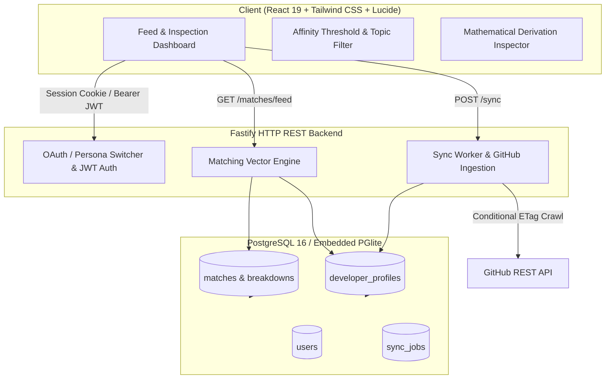

# Developer Network & Mentorship Matcher Platform

> **Automated Pairing Platform via Public GitHub Activity & Vector Profiles**
> Designed for junior developers, open-source maintainers, and engineering teams to establish high-fidelity mentorship pairings grounded in empirical code activity.

---

## 🌟 Overview

The **Developer Network & Mentorship Matcher** is a full-stack, data-driven mentorship pairing platform. Rather than relying on self-reported developer interests or subjective survey forms, the platform extracts signals directly from **public GitHub repository activities**, generating continuous vector profiles across:
1. **Linguistic byte footprints** (normalized language distributions across pushed repositories)
2. **Topic & technology affinities** (repository topics, frameworks, and domain tags)
3. **Verified commit velocity** (rolling 90-day push frequency)

Pairings are computed using deterministic mathematical formulations combining Cosine Similarity, Jaccard Index, and Recency Dampening, with full visual inspection of every match's mathematical derivation.

---

## 📐 System Architecture



---

## 🧮 Mathematical Scoring Formulation

The composite match score between a mentee ($J$) and prospective mentor ($M$) is formulated as:

$$\text{MatchScore} = (0.55 \times S_{\text{lang}}) + (0.30 \times S_{\text{topic}}) + (0.15 \times S_{\text{activity}})$$

### 1. Language Vector Affinity ($S_{\text{lang}}$) — Weight: 55%
Calculates the **Cosine Similarity** between the normalized language byte distribution vectors $\vec{J}$ and $\vec{M}$:

$$S_{\text{lang}} = \frac{\sum_{i=1}^{n} (J_i \cdot M_i)}{\sqrt{\sum_{i=1}^{n} J_i^2} \cdot \sqrt{\sum_{i=1}^{n} M_i^2}}$$

### 2. Topic & Ecosystem Affinity ($S_{\text{topic}}$) — Weight: 30%
Calculates the **Jaccard Similarity Index** over the union and intersection of repository topics:

$$S_{\text{topic}} = \frac{|\text{Topics}_J \cap \text{Topics}_M|}{|\text{Topics}_J \cup \text{Topics}_M|}$$

### 3. Recent Commit Velocity Dampener ($S_{\text{activity}}$) — Weight: 15%
Measures mentor availability and verified code activity over a rolling 90-day window, benchmarked against a target of 45 commits:

$$S_{\text{activity}} = \min\left(1.0, \frac{\text{Commits}_{90d}}{45}\right)$$

### 4. Recommendation Threshold
Prospective pairings surface on the recommendation feed if and only if:

$$\text{MatchScore} \ge 0.65$$

---

## 🛠️ Tech Stack

- **Frontend**:
  - React 19 + TypeScript
  - Tailwind CSS + Glassmorphism UI tokens
  - Lucide React Icons
  - SWR (stale-while-revalidate data fetching)
  - Canvas Confetti (celebratory pairing acceptances)
  - Vite 6 bundler

- **Backend**:
  - Fastify v4 + TypeScript
  - PGlite (Zero-dependency embedded PostgreSQL 16 WebAssembly/Node runtime) with fallback to external PostgreSQL
  - `@fastify/jwt` & `@fastify/cookie`
  - `@fastify/cors` & `@fastify/static`
  - AES-256-GCM token encryption for secure OAuth credential storage
  - Pino + Pino-Pretty logging

- **Testing & Tooling**:
  - Vitest test suite with in-memory database isolation
  - Tsx watcher for development

---

## 🚀 Quickstart Guide

### 1. Prerequisites
- Node.js `>= 18.0.0`
- npm `>= 9.0.0`

### 2. Installation
Clone the repository and install all dependencies:
```bash
git clone https://github.com/ademolaadepo28-arch/Developer-Network-Mentorship-Matcher.git
cd Developer-Network-Mentorship-Matcher
npm install
```

### 3. Database Seeding
Seed the embedded PGlite database with pre-configured developer personas, language distributions, and verified activity vectors:
```bash
npm run seed
```

### 4. Development
Start both the Fastify backend server and Vite client concurrently:
```bash
npm run dev
```
- Client dashboard: [http://localhost:5173](http://localhost:5173)
- API server: [http://localhost:3000](http://localhost:3000)
- Health check: [http://localhost:3000/health](http://localhost:3000/health)

### 5. Running the Test Suite
Execute the Vitest test suites covering matching algorithms, cosine calculations, Jaccard similarities, and Fastify REST contracts:
```bash
npm test
```

### 6. Production Build
Compile TypeScript and build optimized production bundles:
```bash
npm run build
npm start
```

### 7. Docker & Fly.io Deployment
Build and run the multi-stage Alpine container locally:
```bash
docker build -t developer-network-mentorship-matcher .
docker run -p 3000:3000 developer-network-mentorship-matcher
```

Deploy directly to Fly.io using the included `fly.toml`:
```bash
fly launch
fly deploy
```

---

## 📡 API Reference Contract

| Method | Endpoint | Description |
| :--- | :--- | :--- |
| `GET` | `/health` | Service health status and uptime |
| `GET` | `/api/v1/auth/me` | Current authenticated session profile |
| `GET` | `/api/v1/auth/personas` | Switch between mock persona profiles |
| `POST` | `/api/v1/auth/login-persona` | Authenticate as a specific persona |
| `PUT` | `/api/v1/auth/role` | Update developer role (`mentor`, `mentee`, `both`) |
| `GET` | `/api/v1/matches/feed` | Feed of mentors exceeding affinity threshold (default `0.65`) |
| `POST` | `/api/v1/matches/:id/request` | Transition match state from `suggested` to `requested` |
| `POST` | `/api/v1/matches/:id/accept` | Transition match state from `requested` to `accepted` |
| `GET` | `/api/v1/matches/:id/breakdown` | Full mathematical derivation and sub-score metrics |
| `POST` | `/api/v1/sync` | Trigger asynchronous background crawl with ETag conditional caching |
| `GET` | `/api/v1/sync/status` | Current status of GitHub background ingestion worker |

---

## 🔐 Rate-Limit Mitigation & Token Security

- **ETag / 304 Not Modified Caching**: Avoids consuming GitHub API quota on unchanged repositories.
- **AES-256-GCM Encryption**: Encrypts GitHub personal access tokens at rest in `users.encrypted_gh_token` using an initialization vector and authentication tag.
- **Role Isolation**: Automatic mutual exclusion prevents mentees from matching with themselves.
